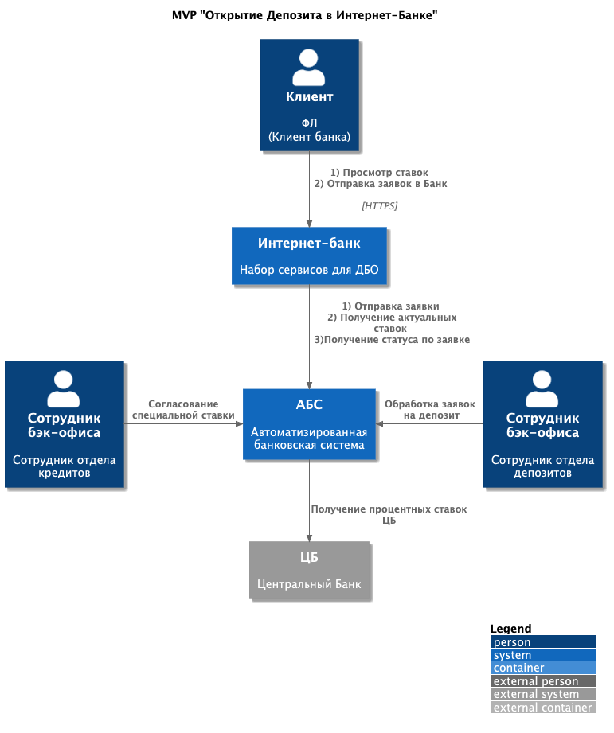
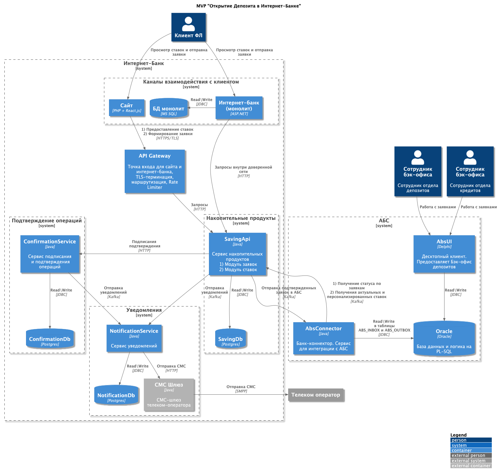
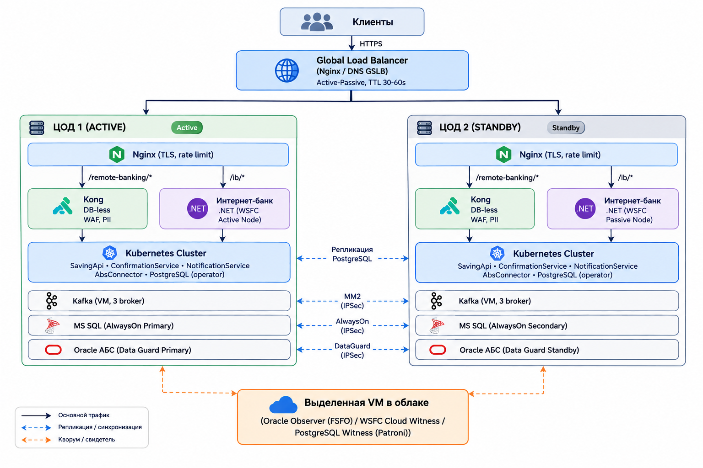

### Название задачи:
MVP. Концептуальная архитектура "Открытие депозитов" 

### Автор:
Команда цифровой трансформации

### Дата:
17.11.2026

### Глоссарий 

| **Сокращение** | **Описание**                                                                                                                   |
|:--------------:|:-------------------------------------------------------------------------------------------------------------------------------|
|      АБС       | Автоматизированная банковская система - набор модулей составляющих ядро Банка                                                  |
|      ДБО       | Дистанционное Банковское Обслуживание - набор сервисов (новых + Интеренет-Банк) предоставляющих пользователю Банковские услуги |
|       ИБ       | Интеренет-Банк (монолитное приложение)                                                                                         |

### Функциональные требования

| **№** | **Действующие лица или системы**       | **Use Case**                              | **Описание**                                                                                                                                                                                                                                                                                                                                                                                                                                                                                                                                                                                                                                  |
|:-----:|:---------------------------------------|:------------------------------------------|:----------------------------------------------------------------------------------------------------------------------------------------------------------------------------------------------------------------------------------------------------------------------------------------------------------------------------------------------------------------------------------------------------------------------------------------------------------------------------------------------------------------------------------------------------------------------------------------------------------------------------------------------|
|   1   | Клиент, ДБО                            | Прием заявки на депозит из Интернет-Банка | 1. Клиент зашел в Интернет-Банк  2. Интернет-Банке выводит список доступных депозитов с актуальными и персонализированными ставками  3. Клиент указывает счёт и сумму депозита   4.Система генерирует код подтверждения и отправляет его в клиенту СМС   5. Пользователь вводит полученный СМС код в окне ПЭП   6. Система проверяет корректность СМС кода, кол-во попыток   7. Система меняет статус заявки на "Принят", клиент видит окно успеха                                                                                                                                                                    |
|   2   | Клиент, Сайт                           | Прием заявки на депозит с сайта           | 1. Новый клиент зашел на сайт банка 2. Сайт показывает список доступных депозитов с актуальными ставками 3. Новый клиент выбирает депозит, вводит номер телефона и Ф. И. О. 4. Система проверяет корректность введённых данных 5. Система сохраняет заявку и присваивает ей статус «Создана» 6. Система передаёт заявку в систему кол-центра для просмотра менеджером 7. Клиент видит окно успеха с информацией о дальнейших шагах (звонок менеджера и визит в отделение для идентификации)                                                                                                                           |
|   3   | ДБО, АБС                               | Передача заявки на депозит в АБС из ДБО   | 1. ДБО публикует подтверждённую заявку в Kafka (топик для AbsConnector) 2. AbsConnector читает сообщение из Kafka и записывает заявку в таблицу ABS_INBOX в Oracle АБС 3. АБС читает поступающие нотификации из таблицы ABS_INBOX регистрирует заявку 4. ДБО получает подтверждение, что заявка передана в АБС 5. Статус заявки в ДБО меняется на "Отправлена в АБС"                                                                                                                                                                                                                                                          |
|   4   | Клиент, ДБО, АБС, Сотрудники Бек-офиса | Обработка заявки на депозит               | 1. Сотрудник бэк-офиса открывает AbsUI и видит новую заявку 2. Сотрудник проверяет условия заявки и доступные ставки 3. Сотрудник подтверждает ставку по заявке в АБС 4. АБС сохраняет подтверждённые условия и меняет статус заявки на «Условия подтверждены» 5. АБС записывает событие в ABS_OUTBOX 6. AbsConnector читает событие из ABS_OUTBOX и публикует статус в Kafka 7. ДБО получает статус и обновляет заявку в своей БД 8. ДБО инициирует отправку СМС клиенту о подтверждении размера ставки 9. Клиент получает СМС об открытии депозита 10. Статус заявки в ДБО меняется на «Депозит открыт» | |

### Нефункциональные требования

| **№** | **Требование**                                                                                                                                                                                                |
|:-----:|:--------------------------------------------------------------------------------------------------------------------------------------------------------------------------------------------------------------|
|   1   | Сервисы депозитного направления должны быть доступны 24/7; целевой уровень доступности — 99,9%.                                                                                                               |
|   2   | В случае сбоя в ЦОД должна быть предусмотрена возможность переключения на резервный ЦОД; новые сервисы должны проектироваться с учётом горизонтального масштабирования.                                       |
|   3   | Интернет-банк и сайт не должны напрямую вызывать API АБС в новом депозитном процессе. Взаимодействие — через сервис заявок и интеграционный слой/очередь.                                                     |
|   4   | АБС остаётся системой-источником для подтверждения условий и открытия депозита; АБС масштабируется только вертикально, поэтому её нагрузка должна быть защищена асинхронной обработкой и буферизацией заявок. |
|   5   | Отклик по операциям интерфейса должен быть максимально быстрым — миллисекунды; справочные данные должны загружаться менее чем за секунду.                                                                     |
|   6   | Список депозитов и ставок должен отдаваться из кэша/сервиса ставок, а не прямым запросом в перегруженную АБС.                                                                                                 |
|   7   | Передача данных с сайта и из интернет-банка должна защищаться шифрованием трафика; чувствительные данные не должны попадать в логи.                                                                           |
|   8   | При доработках нужно максимально использовать существующие технологии банка: MS SQL, Oracle и совместимые платформы разработки.                                                                               |
|   9   | Новые технологии должны быть совместимы с существующими платформами; внутри банка должна быть экспертиза по используемым языкам программирования.                                                             ||
|  10   | СМС-подтверждение и СМС-уведомления реализуются силами команды банка через адаптер к существующему СМС-ядру без доработки подрядчика.                                                                         |
|  11   | Интерфейс должен соответствовать системе дизайна банка: привычные цвета и брендированные элементы.                                                                                                            |
|  12   | Должна быть предусмотрена документация для дальнейшего расширения системы.                                                                                                                                    |

### Решение

1) **Асинхронность и изоляция (Банк-коннектор)**:
АБС масштабируется только вертикально, и ее БД перегружена. Прямые синхронные вызовы API АБС из каналов или новых сервисов создают риск недоступности банка.
Новый сервис AbsConnector изолирует АБС, принимая заявки через Kafka и записывая их в таблицы ABS_INBOX/ABS_OUTBOX. Это обеспечивает буферизацию, сглаживает пиковую нагрузку 
и гарантирует доставку.

2) **Отдельный сервис уведомлений**: 
Выделение NotificationService позволяет переиспользовать его для любых продуктов банка (кредиты, карты) и каналов (СМС, Push, Email). 
Это централизует управление шаблонами, очередями отправки и обработкой ошибок телеком-операторов. Доработка уведомлений не будет требовать изменений в АБС   

3) **Отдельный компонент подписания**:
ConfirmationService изолирует логику генерации, валидации и контроля попыток ПЭП (СМС-кодов). Это позволяет переиспользовать единый механизм безопасности для любых операций (переводы, кредиты) и обеспечивает централизованный аудит.

4) **Сервис накопительных продуктов как модульный монолит (ставки + заявки)**: 
Для MVP деплой одного приложения с двумя логическими модулями проще в разработке и эксплуатации, чем управление двумя микросервисами. 
Хранение ставок в реляционной БД (Postgres) с кэшированием на уровне приложения и индексами по клиентам выбрано для минимизации новых технологий (отказ от Redis), так как данные обновляются редко. 

5) **Адаптация под ограничения (.NET 4.5 и Kafka)**:
Текущая платформа Интернет-банка (.NET Framework 4.5) несовместима с Kafka. Поэтому для интеграции ИБ с новым контуром используется синхронный REST API. Внутри нового контура (между SavingApi, ConfirmationService и AbsConnector) применяется Kafka для асинхронной обработки.

6) **Обеспечение доступности (Отказоустойчивость):** 
Используются два ЦОД. Для Stateful-систем (Oracle, MS SQL, PostgreSQL, Kafka) настроена репликация (Data Guard, AlwaysOn, Patroni, MirrorMaker 2) с шифрованием IPSec. 
Для предотвращения Split-brain и автоматического Failover развернута внешняя кворумная площадка (Cloud VM с Observer и Witness). 
K8s развернут в каждом ЦОД отдельно, синхронизация конфигураций через GitOps.

### Участники процесса

| Компонент                | Назначение                                                                                                                                               |
|:-------------------------|:---------------------------------------------------------------------------------------------------------------------------------------------------------|
| **Сайт банка**           | Публичный канал: просмотр ставок, подача заявки новым клиентом. Интеграция через API Gateway.                                                            |
| **Интернет-банк (ДБО)**  | Канал для существующих клиентов (монолит ASP.NET 4.5). Просмотр ставок, подача заявки, СМС-подтверждение. Вызывает SavingApi напрямую (без API Gateway). |
| **API Gateway**          | Точка входа для **сайта**: TLS-терминация, WAF, Rate Limiter, маскирование PII, маршрутизация.                                                           |
| **SavingApi**            | Новый сервис (Java). Модульный монолит: **Модуль заявок** (статусная модель, оркестрация) и **Модуль ставок** (read-only). Работает с БД PostgreSQL.     |
| **ConfirmationService**  | Сервис подписания и подтверждения операций (генерация/проверка СМС-кодов, контроль попыток).                                                             |
| **NotificationService**  | Сервис уведомлений (отправка СМС через шлюз, управление шаблонами).                                                                                      |
| **AbsConnector**         | Банк-коннектор (Java). Обеспечивает интеграцию с АБС через паттерн Inbox/Outbox (чтение/запись в Oracle).                                                |
| **Kafka**                | Шина сообщений для асинхронного обмена между SavingApi, ConfirmationService, NotificationService и AbsConnector.                                         |
| **АБС (Oracle)**         | Система-источник. Согласование ставок, подтверждение условий, открытие депозитов. Взаимодействие только через AbsConnector.                              |
| **Сотрудники бэк-офиса** | Работа с заявками через десктопный клиент AbsUI (Delphi).                                                                                                |
| **Внешняя кворумная VM** | Обеспечение отказоустойчивости (Oracle Observer, WSFC Cloud Witness, Patroni Witness) для предотвращения Split-brain между ЦОД.                          |

#### Контекстная диаграмма

[C4_Context](./DepositsContainer.puml)

#### Диаграмма контейнеров

[C4_Container](./DepositsContainer.puml)

#### Схема развертывание

| Компонент                                       | Что делаем                                                                                | Зачем / Обоснование                                                                                                                                                                            |
|:------------------------------------------------|:------------------------------------------------------------------------------------------|:-----------------------------------------------------------------------------------------------------------------------------------------------------------------------------------------------|
| **Global Load Balancer (Nginx/DNS GSLB)**       | Active-Passive переключение трафика между ЦОД, health-check, TTL 30–60 сек                | Единая точка входа и автоматический перевод пользователей в ЦОД 2 при отказе ЦОД 1. Без GSLB failover ЦОД невозможен.                                                                          |
| **Nginx (входной LB в каждом ЦОД)**             | TLS-терминация, rate limiting, маршрутизация; 2+ экземпляра + Keepalived VIP              | HA внутри ЦОД и защита публичного трафика. Маршрутизирует сайт через Kong, ИБ — напрямую в WSFC.                                                                                               |
| **Kong API Gateway (DB-less)**                  | Только для сайта: TLS, WAF, PII masking, rate limiting; конфигурация через GitOps         | DB-less исключает внешнюю СУБД для gateway и упрощает развертывание. ИБ не прячем за Kong: ему не нужны WAF/PII-функции gateway, а прямой вызов снижает latency и убирает лишнюю точку отказа. |
| **Интернет-банк (.NET 4.5) на WSFC**            | Active-Passive failover-кластер; `MultiSubnetFailover=True` в строке подключения к MS SQL | Обеспечивает доступность монолита при отказе узла или ЦОД. Параметр ускоряет переподключение к новому primary MS SQL без ручного вмешательства.                                                |
| **MS SQL (AlwaysOn)**                           | Репликация БД ИБ между ЦОД; IPSec для канала                                              | Сохранность данных и failover вместе с приложением. IPSec защищает ПДн в репликации.                                                                                                           |
| **Kubernetes (отдельный кластер в каждом ЦОД)** | Развертывание SavingApi, ConfirmationService, NotificationService, AbsConnector           | Отдельные кластеры вместо stretched etcd: кворум etcd на двух ЦОД невозможен без третьего. GitOps синхронизирует конфигурации между кластерами.                                                |
| **PostgreSQL (в K8s через оператор)**           | БД новых сервисов; репликация между ЦОД + witness на внешней VM                           | Оператор упрощает stateful-развертывание. Witness на внешней площадке предотвращает Split-brain Patroni при обрыве DCI.                                                                        |
| **Kafka (выделенные VM, не в K8s)**             | Асинхронная шина; MirrorMaker 2 между ЦОД; IPSec                                          | Kafka stateful и чувствительна к диску/сети — вынос из K8s дает предсказуемость и изоляцию от stateless-нагрузки. MM2 реплицирует топики между ЦОД.                                            |
| **Oracle АБС (Data Guard + FSFO)**              | Primary в ЦОД 1, Standby в ЦОД 2; Observer на внешней VM                                  | RPO≈0 и автоматический failover. Observer инициирует переключение без участия DBA, сокращая RTO до секунд.                                                                                     |
| **Внешняя кворумная VM (облако/офис)**          | Oracle Observer, WSFC Cloud Witness, PostgreSQL Witness                                   | Предотвращает Split-brain при обрыве DCI между ЦОД. Без нее автоматический failover СУБД и WSFC невозможен.                                                                                    |
| **IPSec**                                       | Шифрование каналов репликации (AlwaysOn, Data Guard, MM2, PostgreSQL)                     | Защита ПДн и служебного трафика между ЦОД.                                                                                                                                                     |
| **Маршрутизация ИБ → SavingApi**                | Прямой внутренний HTTP, минуя Kong                                                        | East-west трафик в доверенном сегменте; Kong не добавляет ценности, а лишний hop увеличивает latency и создает точку отказа.                                                                   |

### Альтернативы

| Альтернатива                                            | Описание                                                                                                                                                                                                                                                                                            | Причина отклонения                                                                                                                                                                                                                                                                                                                                                                                                                                                                                                                                                                                                                                                                                                                                                                                                                                   |
|:--------------------------------------------------------|:----------------------------------------------------------------------------------------------------------------------------------------------------------------------------------------------------------------------------------------------------------------------------------------------------|:-----------------------------------------------------------------------------------------------------------------------------------------------------------------------------------------------------------------------------------------------------------------------------------------------------------------------------------------------------------------------------------------------------------------------------------------------------------------------------------------------------------------------------------------------------------------------------------------------------------------------------------------------------------------------------------------------------------------------------------------------------------------------------------------------------------------------------------------------------|
| **Отказ от Kafka на этапе MVP**                         | Использование синхронных HTTP-вызовов или существующей очереди банка для интеграции с АБС и сервисами.                                                                                                                                                                                              | Теряется буферизация заявок, защита перегруженной АБС от пиковых нагрузок и гарантия доставки сообщений при сбоях.                                                                                                                                                                                                                                                                                                                                                                                                                                                                                                                                                                                                                                                                                                                                   |
| **Разделение SavingApi на два микросервиса + Redis**    | Выделение сервиса ставок и сервиса заявок в отдельные деплойменты с использованием Redis для кэширования ставок.                                                                                                                                                                                    | Избыточно для MVP. Усложняет инфраструктуру (новая система Redis), требует дополнительной экспертизы. Хранения в реляционной БД достаточно.                                                                                                                                                                                                                                                                                                                                                                                                                                                                                                                                                                                                                                                                                                          |
| **Отказ от внешней кворумной площадки (только 2 ЦОД)**  | Развертывание систем отказоустойчивости (СУБД, Kafka) только в двух ЦОД без выделенного арбитра.                                                                                                                                                                                                    | При обрыве канала связи между ЦОД возникает Split-brain. Обе площадки теряют кворум, автоматический Failover становится невозможным.                                                                                                                                                                                                                                                                                                                                                                                                                                                                                                                                                                                                                                                                                                                 |
| **Прямой доступ AbsConnector к бизнес-таблицам АБС**    | Запись заявок напрямую в таблицы АБС без использования паттерна Inbox/Outbox.                                                                                                                                                                                                                       | Риск блокировок перегруженной БД АБС, нарушение изоляции систем и паттерна асинхронной интеграции.                                                                                                                                                                                                                                                                                                                                                                                                                                                                                                                                                                                                                                                                                                                                                   |
| **Реализация MVP в CRM-системе кол-центра (подрядчик)** | Использовать существующую CRM-платформу подрядчика (Java Spring Boot, PostgreSQL, React.js, микросервисы) для хранения и обработки заявок на депозит, а также для отображения заявок менеджерам кол-центра. Банк уже имеет нескольких Java-специалистов, которые могут вносить изменения в систему. | ) Доменное несоответствие: CRM спроектирована для автоматизации взаимоотношений с клиентами (call center), а не для банковских продуктов. Ставки, интеграция с АБС и СМС-подтверждение — это банковские функции, которые потребуют значительной кастомизации платформы подрядчика. 2) Зависимость от подрядчика: Ядро системы обновляется подрядчиком; банк может вносить изменения лишь «периодически» по запросу бизнеса. Для MVP с быстрыми итерациями это блокер (аналогично проблеме .NET-монолита). 3) Безопасность: CRM обрабатывает данные взаимодействия с клиентами, но не финансовые транзакции с тем же уровнем контроля, что и ядро. 4) Интеграция: Потребуется всё равно строить AbsConnector, ConfirmationService и NotificationService — CRM не закрывает эти функции. 5) Data isolation: Смешивание заявок на депозит с CRM-данными |

### Недостатки, ограничения, риски

| Риск/Ограничение                        | Описание                                                                                                                      | Способ снижения/Комментарий                                                                                                          |
|:----------------------------------------|:------------------------------------------------------------------------------------------------------------------------------|:-------------------------------------------------------------------------------------------------------------------------------------|
| **Зависимость от внешней кворумной VM** | Требуется стабильный сетевой канал (VPN/IPSec) и низкая задержка. Потеря связи с площадкой блокирует автоматический Failover. | Резервирование каналов связи, мониторинг доступности (RTT), использование отказоустойчивых облачных провайдеров.                     |
| **Сложность эксплуатации Kafka**        | Требуется развертывание на выделенных VM (не в K8s), настройка MirrorMaker 2 и обеспечение низкой задержки между ЦОД.         | Выделение экспертизы, тщательное документирование, использование Infrastructure-as-Code (IaC) для развертывания.                     |
| **Ограничения legacy .NET (ИБ)**        | Несовместимость с Kafka и монолитная архитектура вынуждают использовать синхронный REST API.                                  | Изоляция логики в SavingApi. В будущем возможна поэтапная модернизация ИБ или вынос части логики.                                    |
| **Риск нехватки экспертизы**            | Внедрение K8s, Kong (DB-less), Kafka и настройка сложных сценариев репликации БД — новые технологии для команды.              | Обучение персонала, привлечение внешних консультантов на этапе проектирования, поэтапное внедрение.                                  |

