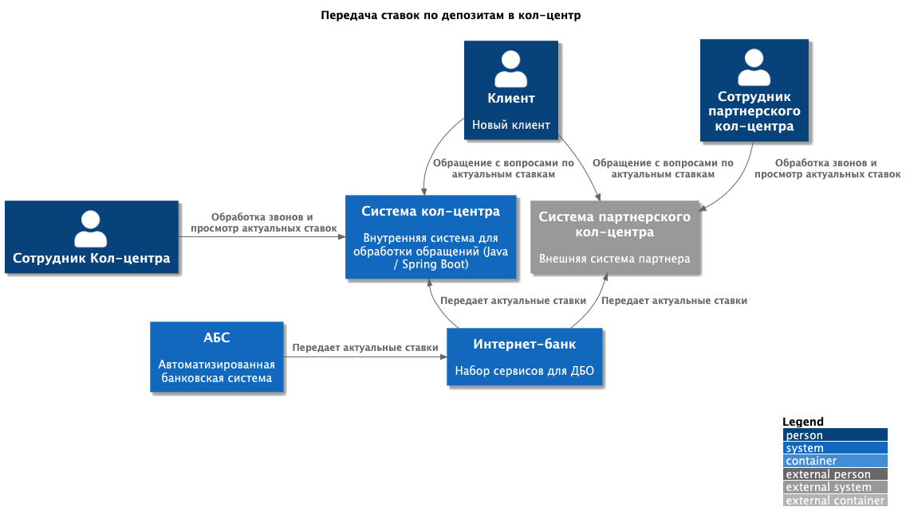
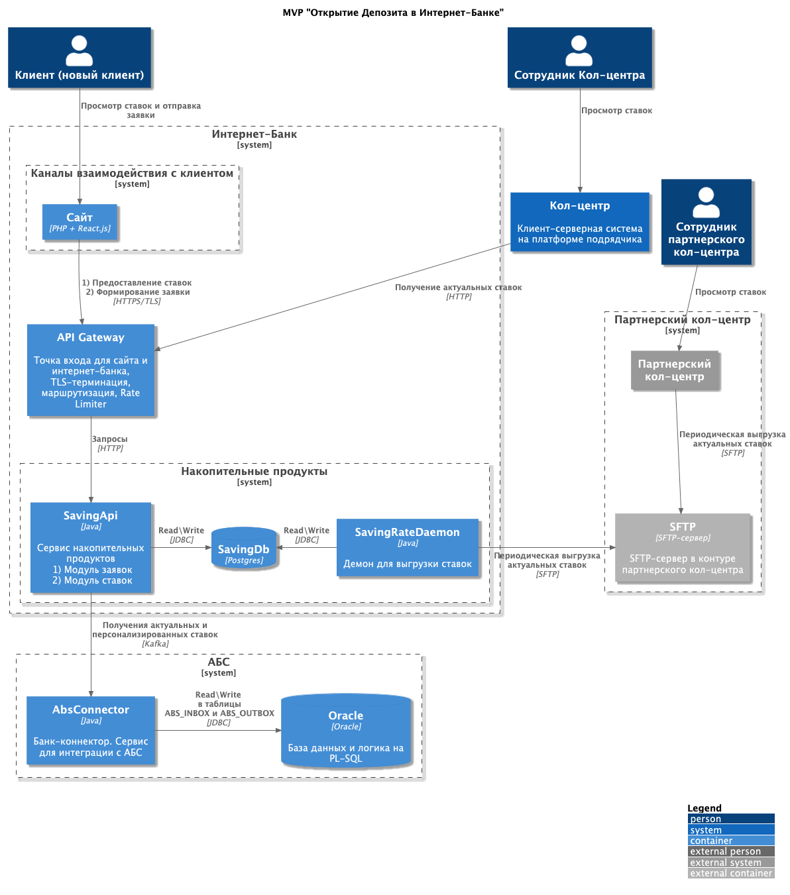

### **Название задачи:** 
Передача ставок в кол-центр

### **Автор:**
Команда цифровой трансформации

### **Дата:**
19.11.2026 

### Функциональные требования
| **№** | **Действующие лица или системы**                                          | **Use Case**                                                      | **Описание**                                                                                                                                                                                                                                                                                                                                                                                                    |
|:-----:|:--------------------------------------------------------------------------|:------------------------------------------------------------------|:----------------------------------------------------------------------------------------------------------------------------------------------------------------------------------------------------------------------------------------------------------------------------------------------------------------------------------------------------------------------------------------------------------------|
|   1   | Сотрудник кол-центра, Система кол-центра, ДБО                             | Просмотр актуальных ставок внутренним кол-центром                 | 1. Сотрудник кол-центра открывает интерфейс системы кол-центра. 2. Система кол-центра отправляет запрос на получение ставок в ДБО. 3. ДБО возвращает актуальные ставки. 4. Сотрудник видит актуальные ставки и консультирует клиента.                                                                                                                                                               |
|   2   | ДБО, SFTP-сервер партнера                                                 | Формирование и выгрузка файла со ставками партнерскому кол-центру | 1. По расписанию ДБО инициирует процесс выгрузки. 2. ДБО выгружает актуальные ставки из своей базы данных. 3. ДБО формирует файл установленного формата (например, CSV/XML). 4. ДБО устанавливает соединение с SFTP-сервером партнера и авторизуется. 5. ДБО передает сформированный файл на SFTP-сервер партнера. 6. При успешной передаче ДБО фиксирует факт выгрузки в логах (и/или БД). |
|   3   | Система партнера, Сотрудник партнерского кол-центра, SFTP-сервер партнера | Использование ставок партнерским кол-центром                      | 1. Система партнера забирает файл с SFTP-сервера. 2. Система партнера парсит файл и обновляет свою базу ставок. 3. Сотрудник партнерского кол-центра видит актуальные ставки в своем интерфейсе и консультирует клиента.                                                                                                                                                                                |
|   4   | АБС, Банк коннектор, ДБО                                                  | Получение актуальных ставок из АБС                                | 1. В АБС происходит обновление или согласование ставок по депозитам. 2. Банк коннектор считывает изменения из АБС (через таблицы OUTBOX/INBOX или очередь сообщений). 3. Банк коннектор передает данные об актуальных и персонализированных ставках в ДБО. 4. ДБО обновляет ставки в своей базе данных для последующего отображения клиентам, сотрудникам кол-центра и выгрузки партнерам.          |
### Нефункциональные требования

| **№** | **Требование**                                                                                                                                                         |
|:-----:|:-----------------------------------------------------------------------------------------------------------------------------------------------------------------------|
|   1   | Интеграция с партнерским кол-центром реализуется **исключительно** через обмен файлами по протоколу SFTP (API-вызовы недоступны).                                      |
|   2   | Процесс выгрузки файлов (SavingRateDaemon) должен выполняться автоматически по расписанию.                                                                             |
|   3   | Передача данных с сайта, интернет-банка и внутреннего кол-центра должна осуществляться по защищенным протоколам (HTTPS/TLS). Передача файлов партнеру — по SFTP (SSH). |
|   4   | Время отклика на запрос ставок для внутреннего кол-центра не должно превышать 1 секунды (в соответствии с общими требованиями к справочным данным).                    |
|   5   | Файл со ставками не должен содержать чувствительных персональных данных клиентов (только общие условия по депозитным продуктам).                                       |

### **Решение**

1) **Выгрузка файлов отдельным демоном (SavingRateDaemon)**.
   Изоляция нагрузки: выгрузка файлов и работа по протоколу SFTP (который может быть медленным или нестабильным) — это тяжелая сетевая и I/O операция. Если делать это внутри SavingApi, то в момент генерации файла или зависания SFTP-соединения могут забиться ресурсы (потоки, память), и клиенты, которые в этот момент открывают депозит на сайте, получат таймаут. Отсутствие проблем с масштабированием: если SavingApi начнет масштабироваться горизонтально, Job внутри него начнет выполняться на каждом инстансе одновременно (потребуются распределенные блокировки). Отдельный демон в единственном экземпляре решает эту проблему из коробки. Отказоустойчивость: падение демона из-за ошибки SFTP не уронит основной сервис по работе с депозитами. SRP: SavingApi занимается онлайн-заявками, а демон — фоновой пакетной обработкой.
2) **Настройка HPA для SavingApi**.
   В случае пиковых нагрузок со стороны внутреннего кол-центра (например, при запуске маркетинговой кампании) сервис будет автоматически масштабироваться. В остальное время ресурсы не будут простаивать.
3) **Доступ внутреннего кол-центра через API Gateway**.
   Система внутреннего кол-центра не обращается напрямую к БД (SavingDb). Запросы идут через API Gateway (TLS-терминация, Rate Limiter), который маршрутизирует их в SavingApi. Это обеспечивает единую точку безопасности, аудита и защищает сервис от перегрузок.
4) **Файловый обмен для партнерского кол-центра**.
   Внешняя система партнера не поддерживает API-вызовы, поэтому интеграция реализуется через SFTP. Демон забирает данные из SavingDb, формирует файл (CSV/XML) и отправляет его на SFTP-сервер партнера. Это соответствует ограничениям партнера и изолирует партнерский контур от банковского.

#### Контекстная диаграмма

[C4_Context](./DepositsContainer.puml)

#### Диаграмма контейнеров

[C4_Container](./DepositsContainer.puml)

### Альтернативы

| Альтернатива                                                 | Описание                                                                                                                           | Причина отклонения                                                                                                                                                                                                                                                                                             |
|:-------------------------------------------------------------|:-----------------------------------------------------------------------------------------------------------------------------------|:---------------------------------------------------------------------------------------------------------------------------------------------------------------------------------------------------------------------------------------------------------------------------------------------------------------|
| **Job-а в рамках SavingApi**                                 | Реализация периодической задачи (например, `@Scheduled` в Spring) внутри самого сервиса SavingApi для генерации и отправки файлов. | Тяжелые I/O и сетевые операции (SFTP) могут блокировать потоки обработки пользовательских запросов. При горизонтальном масштабировании SavingApi потребуется внедрение распределенных блокировок (ShedLock), чтобы избежать дублирования отправки файлов. Нарушает принцип единственной ответственности (SRP). |
| **Создание отдельного микросервиса для управления ставками** | Выделение логики работы со ставками в отдельный микросервис со своей БД, отдельно от SavingApi (заявок).                           | Избыточно для MVP. Ставки и заявки тесно связаны. Разделение добавит сетевые задержки при вызове сервис-сервис и усложнит развертывание. Текущий модульный монолит (SavingApi) + отдельный демон для фоновых задач полностью покрывают потребности.                                                            |
| **Прямой доступ внутреннего кол-центра к БД (SavingDb)**     | Предоставление системе внутреннего кол-центра прямого read-only доступа к базе данных ставок.                                      | Нарушает принципы безопасности и архитектуры. БД не должна быть открыта для прямого доступа из других систем (отсутствует TLS-терминация, rate limiting и аудит на уровне API). Создает жесткую связанность схемы БД с потребителем.                                                                           |

### Недостатки, ограничения, риски

| Риск/Ограничение                                      | Описание                                                                                                              | Способ снижения/Комментарий                                                                                                                                                                                                                  |
|:------------------------------------------------------|:----------------------------------------------------------------------------------------------------------------------|:---------------------------------------------------------------------------------------------------------------------------------------------------------------------------------------------------------------------------------------------|
| **Зависимость от доступности SFTP партнера**          | SFTP-сервер партнера может быть недоступен, медленно отвечать или разрывать соединение, что приведет к сбою выгрузки. | Настроить ретраи (повторные попытки) с экспоненциальной задержкой, таймауты соединения и алертинг в SavingRateDaemon. Использовать уникальные имена файлов (с таймстампом) для предотвращения перезаписи.                                    |
| **Неактуальность данных у партнера (Data Staleness)** | Партнер получает ставки с задержкой, зависящей от расписания выгрузки (например, раз в час или раз в сутки).          | Согласовать SLA по актуальности ставок с бизнесом. Настроить частоту выгрузки в соответствии с бизнес-требованиями. Включать метку времени (timestamp) генерации файла внутрь самого файла.                                                  |
| **Единая точка отказа (SavingRateDaemon)**            | Если демон упадет или зависнет, партнер перестанет получать обновления ставок.                                        | Развернуть демон в Kubernetes с `replicas: 1` (во избежание гонок данных) и настроить Liveness/Readiness probes. Падение пода приведет к его автоматическому перезапуску с сохранением расписания. Настроить мониторинг успешности выгрузок. |
| **Риск утечки данных при передаче**                   | Передача файлов по сети может быть перехвачена.                                                                       | Использовать протокол SFTP (шифрование SSH). Ограничить доступ к SFTP-серверу по IP-адресам (whitelisting). Использовать аутентификацию по ключам (SSH-keys), а не по паролям.                                                               |

### Список крупных задач (Roadmap)

Накопительные продукты. Заявка на депозит (MVP + целевое решение)

#### Q1 (Месяцы 1-3): Фундамент и Бэкенд

T1. Развертывание внешней Quorum VM — настройка Oracle Observer, WSFC Cloud Witness и PostgreSQL Witness для защиты от Split-brain.
T2. Развертывание K8s (2 ЦОД) + GitOps — создание независимых кластеров и настройка Argo CD для синхронизации конфигураций.
T3. Развертывание Kafka (VM) + MM2 — установка брокеров на выделенные VM и настройка MirrorMaker 2 для репликации между ЦОД.
T4. Настройка репликации БД — развертывание PostgreSQL (Patroni), MS SQL (AlwaysOn) и Oracle (Data Guard) с шифрованием IPSec.
T5. Разработка SavingApi (Ставки + Заявки) — создание Java-сервиса и схемы БД PostgreSQL.
T6. Разработка Confirmation/Notification — создание Java-сервисов для генерации СМС-кодов и отправки уведомлений.
T7. Доработка АБС (Oracle) — создание таблиц ABS_INBOX/ABS_OUTBOX и PL-SQL логики для приема заявок и отдачи ставок.

#### Q2 (Месяцы 4-6): Интеграция MVP (Интернет-Банк и Кол-центры)

T8. Разработка AbsConnector — создание Java-сервиса для интеграции SavingApi с АБС через Kafka.
T9. Разработка SavingRateDaemon — создание демона для генерации файлов со ставками и отправки по SFTP.
T10. Интеграция ИБ с SavingApi (REST) — доработка .NET-монолита для синхронных вызовов нового сервиса.
T11. Доработка UI ИБ — добавление окон ПЭП (СМС-подтверждение) и отображения персонализированных ставок.
T12. Интеграция внутреннего КЦ — доработка системы кол-центра для получения ставок по API.
T13. Настройка SFTP для Партнерского КЦ — развертывание SFTP-сервера и настройка получения файлов партнером.
T14. Обновление AbsUI (Delphi) — доработка рабочего места сотрудника бэк-офиса для обработки новых заявок.

#### Q3 (Месяцы 7-9): Целевое решение (Сайт и API Gateway)

T15. Настройка Kong API Gateway (DB-less) — развертывание шлюза для маршрутизации публичного трафика сайта.
T16. Интеграция Сайта через Kong — доработка бэкенда сайта для подачи заявок через API Gateway.
T17. Доработка UI Сайта — создание форм подачи заявки для новых клиентов и отображения актуальных ставок.

#### Q4 (Месяцы 10-12): Оптимизация и Target-архитектура

T18. Миграция ИБ на .NET Core/8 и K8s — постепенный отказ от устаревшего .NET Framework 4.5 и перенос в контейнеры.
T19. Внедрение Kafka в контур ИБ — отказ от синхронных REST-вызовов в пользу асинхронного обмена.
T20. Оптимизация нагрузки — настройка HPA (автомасштабирование) и тюнинг баз данных под пиковые нагрузки.