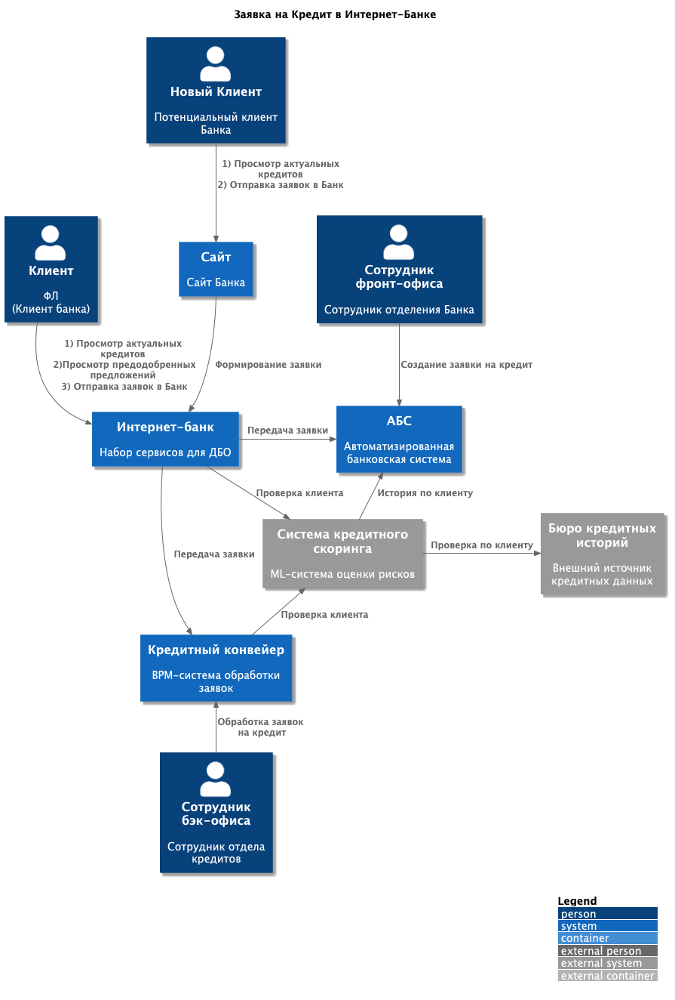
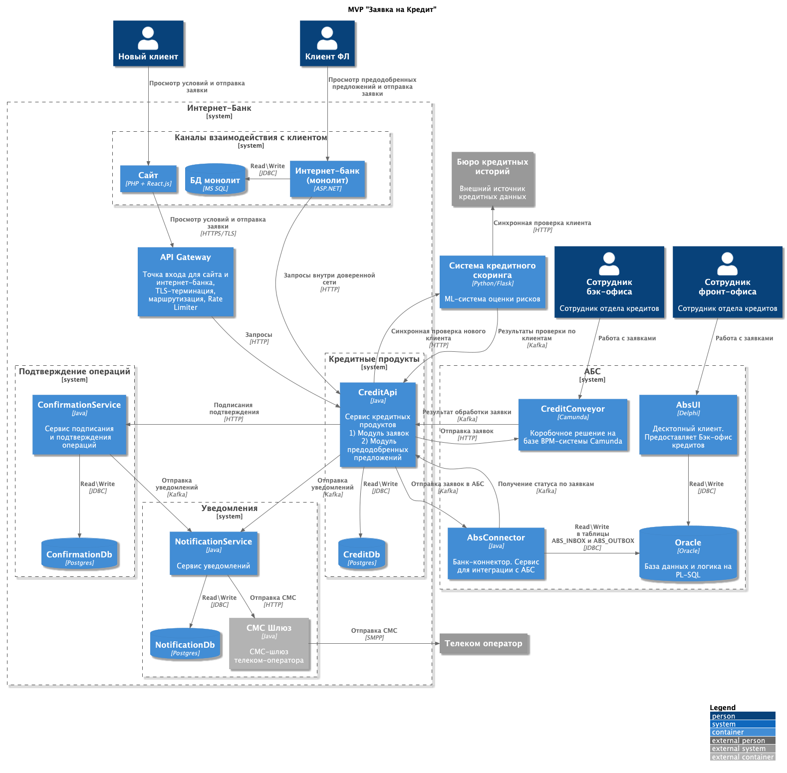

Вот единый ADR для кредитного направления, собранный по аналогии с депозитным документом, с учетом разрыва прямой связи АБС и КК, описанием статичной модели заявки (State Machine) и выделенным разделом «Синхронизация».

---

### **Название задачи:**
MVP. Концептуальная архитектура "Заявка на Кредит"

### **Автор:**
Команда цифровой трансформации

### **Дата:**
20.11.2026

### Глоссарий
| **Сокращение**   | **Описание**                                                                 |
|:-----------------|:-----------------------------------------------------------------------------|
| **АБС**          | Автоматизированная банковская система. Источник истины по клиентам и счетам. |
| **ДБО**          | Дистанционное банковское обслуживание (Сайт, Интернет-Банк).                 |
| **КК**           | Кредитный конвейер. BPM-система на базе Camunda (Oracle).                    |
| **CreditApi**    | Новый сервис (Java). Оркестратор и единая точка истины по статусам заявок.   |
| **AbsConnector** | Сервис интеграции с АБС (через Kafka и Oracle).                              |
| **KKConnector**  | Сервис интеграции с Кредитным конвейером (через REST/Java Delegate).         |

### Функциональные требования

| **№** | **Действующие лица или системы** | **Use Case** | **Описание** |
|:-----:|:---------------------------------|:-------------|:-------------|
| 1 | Новый клиент, Сайт, ДБО, АБС | Подача заявки на кредит с сайта (без паспортных данных) | 1. Клиент вводит ФИО и телефон на сайте. 2. `CreditApi` создает заявку в статусе `DRAFT`. 3. `CreditApi` через `AbsConnector` создает черновик клиента в АБС (статус `DRAFT`). 4. `NotificationService` отправляет СМС: «Приходите в отделение». 5. Менеджер фронт-офиса находит черновик в АБС, вводит паспорт и переводит клиента в `ACTIVE`. 6. АБС пишет событие в `ABS_OUTBOX`. 7. `CreditApi` получает событие, меняет статус заявки на `NEW` и отправляет её в КК. |
| 2 | Новый клиент, Сайт, ДБО, Скоринг | Подача заявки на кредит с сайта (с паспортом) | 1. Клиент вводит ФИО, телефон и паспорт. 2. `CreditApi` создает заявку в статусе `DRAFT`. 3. `CreditApi` синхронно вызывает Скоринг (только БКИ). 4. `CreditApi` создает черновик в АБС и меняет статус заявки на `NEW`. 5. `CreditApi` отправляет заявку в КК, статус `IN_PROGRESS`. 6. Клиент видит результат на сайте, получает СМС о визите в отделение. |
| 3 | Клиент ФЛ, Интернет-Банк, ДБО | Подача заявки по предодобренному предложению | 1. Клиент видит предодобренное предложение в ИБ. 2. Клиент подтверждает заявку СМС-кодом (`ConfirmationService`). 3. `CreditApi` отправляет заявку в КК (АБС не задействована на этом этапе). 4. КК обрабатывает и возвращает статус в `CreditApi`. |
| 4 | Сотрудник бэк-офиса, КК | Обработка заявки в кредитном конвейере | 1. Заявка поступает в КК от `CreditApi`. 2. Бэк-офис обрабатывает заявку (BPMN-процесс). 3. КК формирует финальное решение и отправляет событие в `CreditApi` (через `KKConnector`). |
| 5 | ДБО, СМС-шлюз | Уведомление об изменении статуса | 1. `CreditApi` получает событие о смене статуса. 2. Обновляет `CreditDb`. 3. `NotificationService` отправляет СМС клиенту. |

### Нефункциональные требования

| **№** | **Требование**                                                                                                                          |
|:-----:|:----------------------------------------------------------------------------------------------------------------------------------------|
|   1   | Сервисы кредитного направления должны быть доступны 24/7 с уровнем 99,9%.                                                               |
|   2   | Время отклика интерфейса — миллисекунды. Предодобренные предложения отдаются из `CreditDb`, а не запрашиваются в КК или АБС «на лету».  |
|   3   | Систему кредитного скоринга **запрещено** нагружать фоновыми предрасчетами. Скоринг вызывается только синхронно по факту подачи заявки. |
|   4   | Таймаут ожидания ответа от Скоринга при синхронной подаче не должен превышать 5–10 секунд.                                              |
|   5   | Передача ПДн (паспорт) осуществляется только по HTTPS/TLS. Данные не попадают в логи (маскирование на уровне Gateway и сервисов).       |
|   6   | Операция подачи заявки в ИБ подтверждается СМС-кодом (ПЭП) через `ConfirmationService`.                                                 |
|   7   | Архитектура исключает прямые вызовы API АБС и КК из каналов (Сайт, ИБ). Взаимодействие — только через `CreditApi`.                      |

### **Решение**

Мы делаем `CreditApi` **оркестратором (Saga Coordinator)** и **агрегатом состояния заявки (Application Aggregate)**. Он является единой точкой истины по жизненному циклу заявки.

**1) Разрыв зависимости между КК и АБС.**
Раньше АБС выгружала заявки в КК раз в сутки, что не позволяло обрабатывать предодобренные предложения в тот же день. Теперь прямой интеграции между КК и АБС нет. `CreditApi` управляет обоими контурами:
*   Получив заявку из канала (Сайт/ИБ) или событие из АБС (через `AbsConnector`), он сам инициирует старт процесса в КК.
*   КК возвращает статусы только в `CreditApi`.
    Это позволяет обходить суточный батч и передавать заявки в КК мгновенно.

**2) Интеграция с Camunda (КК).**
Взаимодействие строится через `KKConnector` (отдельный компонент, чтобы не смешивать протоколы Oracle/JDBC для АБС и REST/JSON для Camunda):
*   **Команды (CreditApi → KK):** `CreditApi` публикует команду в Kafka (или вызывает REST), `KKConnector` вызывает `POST /process-definition/key/{key}/start` в Camunda, передавая `businessKey = application_id`.
*   **События (KK → CreditApi):** В BPMN-диаграмме Camunda добавляются **External Tasks** (или Java Delegates). Когда процесс доходит до нужного шага, Camunda генерирует задачу. `KKConnector` забирает её (Pull) и публикует событие в Kafka, откуда его читает `CreditApi`. Это устойчиво к сбоям и не требует прямого доступа к БД КК.

**3) Предсоздание карточки клиента.**
Для ускорения работы отделения `CreditApi` через `AbsConnector` создает черновик клиента в АБС (`status=DRAFT`). Менеджеру в отделении остается только подтвердить паспорт и перевести клиента в `ACTIVE`.

**4) Обеспечение надёжности (Transactional Outbox).**
Чтобы избежать рассинхронизации между БД и Kafka, `CreditApi` использует паттерн Transactional Outbox. Статус и событие пишутся в БД в одной транзакции, а фоновый процесс вычитывает их в Kafka. Это гарантирует доставку событий.

#### Контекстная диаграмма

[C4_Context](./CreditContext.puml)

#### Диаграмма контейнеров

[C4_Container](./CreditContainer.puml)

#### Синхронизация и статичная модель заявки

**Статичная модель (State Machine) в CreditApi:**

| Статус                  | Что означает                                                     | Кто переводит                                          |
|:------------------------|:-----------------------------------------------------------------|:-------------------------------------------------------|
| `DRAFT`                 | Заявка создана, но не готова (нет паспорта / клиент не пришел)   | `CreditApi` при создании                               |
| `NEW`                   | Заявка готова к отправке в КК (паспорт введен / скоринг пройден) | `CreditApi` по событию из АБС / по результату скоринга |
| `IN_PROGRESS`           | Заявка отправлена в КК, идет обработка                           | `CreditApi` после команды `start_process`              |
| `APPROVED` / `REJECTED` | КК вынес финальное решение                                       | `CreditApi` по событию из `KKConnector`                |
| `ISSUED`                | Кредит выдан в АБС                                               | `CreditApi` по событию из `AbsConnector`               |
| `CANCELLED`             | Заявка отменена (таймаут/отказ клиента)                          | `CreditApi`                                            |

**Механизм синхронизации:**
1.  **Идемпотентность:** Каждое событие имеет `event_id`. `CreditApi` хранит обработанные `event_id` и игнорирует дубликаты. Отправка в КК идет с `idempotency_key = application_id + target_status`.
2.  **Failure Compensation (Saga):** Если КК недоступен, `CreditApi` ретраит отправку команды. Если АБС недоступна при создании черновика, заявка остается в `DRAFT` до восстановления связи.
3.  **Аудит:** Все переходы статусов логируются в `CreditDb` с указанием источника (Сайт, ИБ, АБС, КК) и времени.

#### Участники процесса

| Компонент | Назначение |
|:---|:---|
| **Сайт / Интернет-Банк** | Каналы подачи заявок. |
| **CreditApi** | Оркестратор, State Machine, агрегатор статусов. |
| **AbsConnector** | Адаптер к АБС (Oracle). Работает через Inbox/Outbox. |
| **KKConnector** | Адаптер к Camunda (КК). Работает через REST + External Tasks/Kafka. |
| **Система скоринга** | Вызывается синхронно при подаче заявки. |
| **ConfirmationService** | Генерация и проверка СМС-кодов. |
| **NotificationService** | Отправка СМС клиентам. |
| **АБС (Oracle)** | Хранит карточки клиентов (DRAFT/ACTIVE) и факты выдачи. |
| **КК (Camunda)** | Выполняет BPMN-процесс кредитования и выносит решение. |

### **Альтернативы**

| Альтернатива                                    | Описание                                                        | Причина отклонения                                                                                                                                               |
|:------------------------------------------------|:----------------------------------------------------------------|:-----------------------------------------------------------------------------------------------------------------------------------------------------------------|
| **Прямая интеграция АБС ↔ КК (Status Quo)**     | Оставить существующую схему, где КК сам забирает заявки из АБС. | Не позволяет обрабатывать предодобренные предложения в тот же день (суточный батч). Создает жесткую связанность двух legacy-систем.                              |
| **КК как оркестратор (Camunda управляет всем)** | Передать логику вызовов АБС и Скоринга в BPMN-процесс Camunda.  | Нагружает КК несвойственной ему функцией интеграции с legacy (АБС) и ПДн. Усложняет изменение процессов (требует правок Java-кода подрядчика).                   |
| **Чтение/запись напрямую в Oracle КК**          | `CreditApi` ходит в БД Camunda напрямую (JDBC).                 | Нарушает инкапсуляцию BPM-движка. Любое обновление Camunda сломает интеграцию. Обход BPMN-логики.                                                                |
| **External Task vs Java Delegate в Camunda**    | Использовать только один способ интеграции.                     | Выбран гибрид: REST для команд (старт процесса) и External Task/Kafka для событий (статусы). Это дает устойчивость и минимальное вмешательство в код подрядчика. |

### **Недостатки, ограничения, риски**

| Риск/Ограничение                         | Описание                                                                 | Способ снижения/Комментарий                                                                                            |
|:-----------------------------------------|:-------------------------------------------------------------------------|:-----------------------------------------------------------------------------------------------------------------------|
| **Dual-write problem (БД + Kafka)**      | Риск рассинхронизации при записи статуса в БД и отправке события.        | Использование паттерна Transactional Outbox в `CreditApi`.                                                             |
| **Задержка при External Task (Polling)** | При использовании Pull-модели события из КК могут приходить с задержкой. | Настроить `asyncResponseTimeout` (long polling) в Camunda. Использовать Java Delegate + Kafka, если задержка критична. |
| **Отказ Скоринга в момент подачи**       | Синхронный вызов может упасть по таймауту.                               | Заявка переводится в асинхронную обработку. Клиенту показывается нейтральное сообщение, СМС приходит позже.            |
| **Сложность поддержки State Machine**    | Множество переходов статусов и систем-участников.                        | Четкая документация (State Machine), сквозной `application_id`, покрытие интеграционными тестами.                      |
| **Дублирование заявок**                  | Клиент может подать заявку на сайте и в отделении.                       | Дедупликация по номеру телефона и `application_id`. Блокировка создания дубликатов в `CreditApi`.                      |